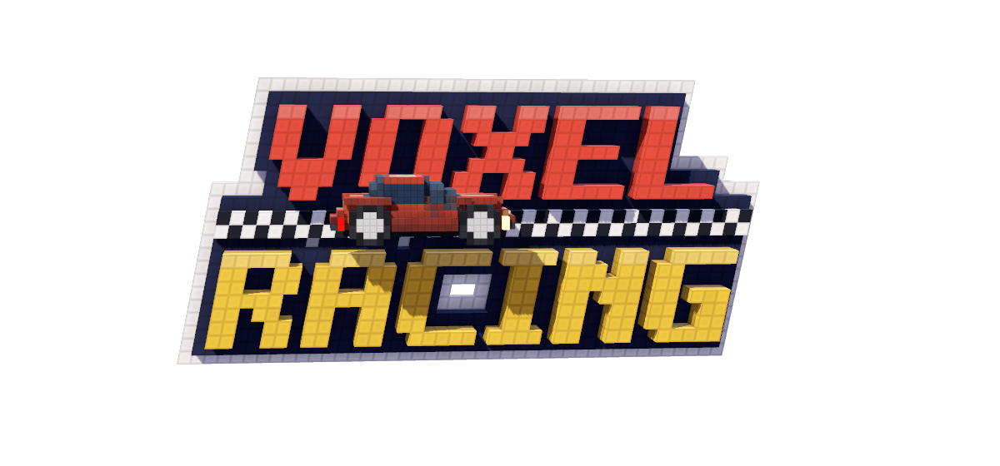
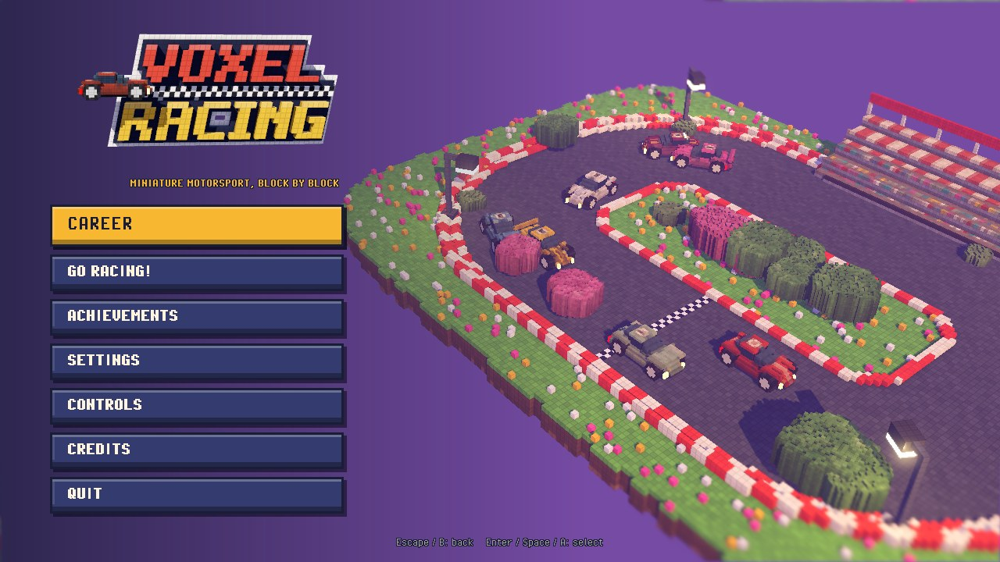
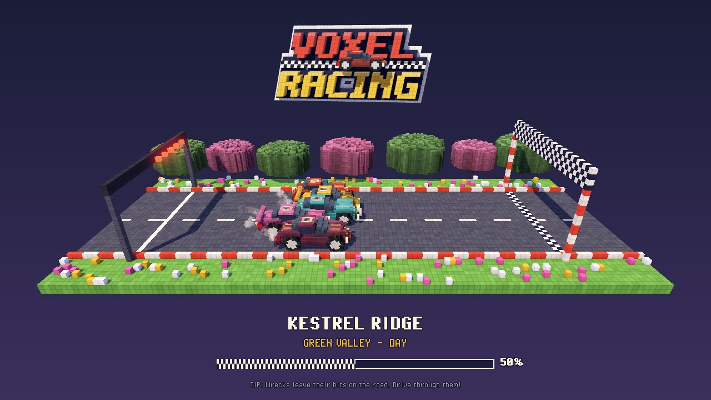
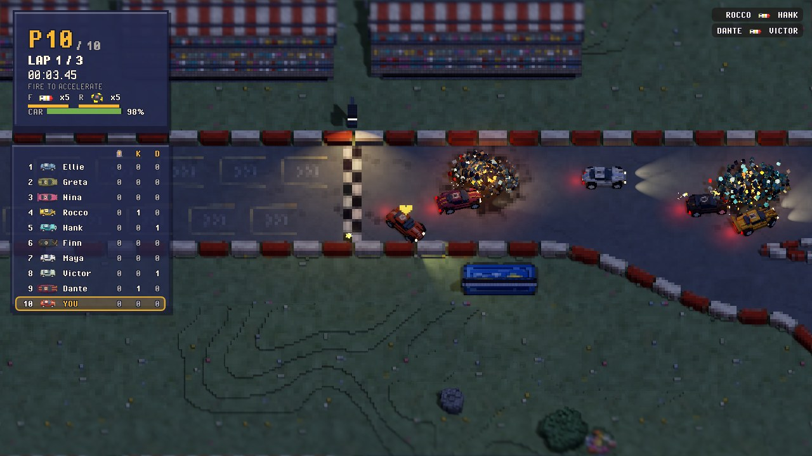
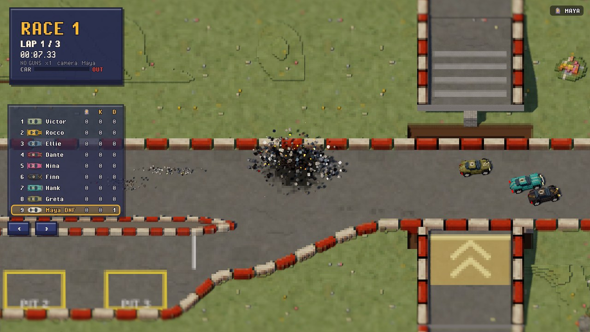

<p align="center"></p>

# VoxelRacing

**Miniature motorsport, block by block.** A combat racing game built from
voxels: little voxel race cars that break apart bit by bit, blow up into
chunks of their own colours and leave their debris and burn marks on the
track for the rest of the race. Underneath runs HyperCars' racing
simulation (handling, AI rivals, weapons, rules, career, music and voices).

**Download:** the GitHub Actions *Windows build* workflow uploads a portable
Windows x64 folder for every push (Actions tab, latest run, artifact).
Extract it and run `VoxelRacing.exe`.

## Prototype history

- **Prototype 001 - The Voxel Experiment** (branch `checkpoint/prototype-001`):
  HyperCars' world, cars and scenery converted to voxels.
- **Prototype 002 - A World of Voxels**: its own identity. New logo and
  Pixel Operator typography, voxel-block interface, a living voxel diorama
  as the main menu, "The Little Race" loading screen, voxel car icons,
  progressive voxel damage, voxel explosions, persistent debris that cars
  scatter, burn marks, voxel collision stars and sparks, voxel missiles and
  mines, Battle Royale in voxels, and the inherited 2D presentation removed.
  Screenshots of the running game: `docs/screenshots/p002/`.

<p align="center">




</p>

## Keys

| Key | |
|---|---|
| **V** | Cycle the camera: MINIATURE (58 deg), HIGH (72), LOW (44), TOP-DOWN |
| **L** | Night lighting on / off (also TIME: NIGHT on the setup screen) |

All other controls are HyperCars' (CONTROLS in the menu; see below).

## How it works

- **Simulation untouched.** The race is HyperCars' 2D simulation; its 2D
  world is kept as data (physics, track geometry, placements) and culled from
  the screen. `VoxelStage` (`src/voxel/`) mirrors it in 3D every frame.
- **Camera.** Orthographic, pitched, never yawed: the ground maps to the
  screen affinely, so the remaining 2D ground decals (tyre marks, burn marks,
  the mine halo, the Battle Royale zone) are rendered into a small viewport
  and projected onto the voxel road under the cars.
- **World conversion** (`voxel_track.gd`): each circuit (and the Battle
  Royale arena) is rendered offscreen into colour and class maps, turned into
  a heightfield and greedy-meshed in time slices while the loading race runs.
  Bridges are real decks; the flyover gap is a real gap.
- **Cars** (`voxel_cars.gd`): every car drawing becomes a voxel model (body,
  glass cabin, roof roundel, wheel arches, rear wing where drawn, bumpers,
  head lamps on the nose, tail lamps on the tail). Damage, debris and
  explosions derive from each car's own voxel model (`voxel_car_damage.gd`),
  so custom cars get them for free.
- **Effects** (`voxel_fx.gd`, `voxel_race_fx.gd`): instanced voxel debris
  (bounces, settles, persists, kicked about by passing cars through a spatial
  hash), sparks, fire, smoke puffs, voxel stars; all driven by the existing
  damage, combat and collision events.
- **Interface** (`src/ui/vr_style.gd`, `hyper_theme.gd`): VoxelRacing palette,
  Pixel Operator (CC0), generated voxel-block buttons and panels.
- **Branding**: the logo is a live voxel model (`voxel_logo.gd`);
  `tools/make_branding.gd` bakes `assets/branding/` (window icon, splash).

Developer tools (run under Xvfb): `tools/smoke_flow.gd` (end-to-end smoke
test with simulated keys), `tools/capture_race.gd` (screenshots of any
circuit, biome, time, camera; `--hurt` damages a car to show damage and
explosions), `tools/fx_check.gd` (damage, explosion, debris, burn mark and
fresh-race reset counts), `tools/screens_tour.gd`, `tools/car_showroom.gd`,
`tools/logo_preview.gd`.

## Known limitations

- The Windows `.exe` file itself keeps Godot's icon (the window uses the
  VoxelRacing icon); stamping the exe needs rcedit on the build machine.
- 2D ground decals are not drawn on bridge decks; effects on a deck lie at
  deck height but missiles there are drawn slightly above it.
- Some inherited GUT tests still describe the HyperCars presentation and were
  not maintained for this prototype.

---

# HyperCars (inherited README)

A top-down combat racing game in Godot 4.7, mechanically faithful to *Super Cars II* (Gremlin, 1991) with original, hand-painted HyperCars artwork. Ten cars race: you and nine recurring rivals with their own personalities, or two players with eight rivals.

## Run

- Open the folder in **Godot 4.7.x** (developed with 4.7.2-stable, GL Compatibility renderer) and press Play.
- Command line: `godot --path .`
  - `-- --seed=N` replays a whole session's rival decisions.
  - `-- --layout=<id>` preselects a circuit.

## What is in the game

**CAREER** is the heart of the game: start as an unknown racer and win the Rookie Cup,
the Pro Series and the HyperCars Grand Championship (with its seven-lap Grand Final) to
become the HyperCars Champion. You race with your own saved garage between rounds,
your progress is saved after every round, and the career ends with a victory ceremony
and the Hall of Fame. Afterwards you can replay any championship or play every other
mode. See `docs/CAREER.md`.

**GO RACING!** opens a shared setup screen with a rotating circuit preview. The modes are:

| Mode | What it is |
|---|---|
| Quick Race | Standard weapons, any circuit / environment / time / length |
| Garage Race | Prize money, your own weapons, repairs and armour; the career is saved |
| Championship | Six rounds (or three) ending in a grand final; win a rival's car |
| Knockout | Nine laps, last place out every lap |
| Battle Royale | One arena, no respawns, last car standing |
| Spectate | The nine rivals race; follow any driver |
| Multiplayer | Couch split-screen, or LAN / online |

The game has:
- **3 circuits:** Kestrel Ridge, Larkspur Ring, Ravenhook. They include bridges, narrowings and speed-dependent jumps.
- **5 environments:** Green Valley, Wasteland, Winter, The Raceway and Tabletop Mayhem. Each has its own modest handling, identical for every car.
- **Day / night** on any combination.
- **Weapons:** Classic or Tactical combat style, or No Guns.
- **Vehicle damage**, a kill feed and TOMBSTONE | K | D statistics.
- **Achievements** and rival careers.
- **The official music** and an announcer with rival taunts.

## Controls

The defaults below can be changed in **CONTROLS**: every action takes two keyboard keys and two controller inputs.

| Action | Keyboard | Controller |
|---|---|---|
| Steer left / right | arrow keys / A, D | d-pad / left stick |
| Fire (accelerate or brake, by control mode) | Space / Ctrl | A |
| Front / rear weapon | Up / Down, W / S | d-pad / stick up / down |
| Confirm (results, standings, garage) | Enter | Start |
| Back / race menu | Esc | B |

Fire never dismisses a results or standings screen. The game's hints always show your current bindings.

## Your own art and audio

Put replacement files in a `custom/` folder: in the project while developing, or next to the exported Windows / Linux game. Restart the game to apply them; no rebuild is needed. Missing or broken files fall back to the packaged `template_` assets.

- Per-asset contract: [`docs/ASSET_SPECS.md`](docs/ASSET_SPECS.md).
- Rules: [`assets/README.md`](assets/README.md).

## Saved data (`user://`)

| File | Contents |
|---|---|
| `settings.cfg` | Volumes and setup choices |
| `controls.cfg` | Your bindings |
| `garage.cfg` | Garage career |
| `car_collection.cfg` | Won cars and the Racing for Keeps stake |
| `achievements.cfg` | Achievements and rival careers |

## Tests

```bash
godot --headless --path . --import
```

```bash
godot --headless --path . --fixed-fps 60 -s addons/gut/gut_cmdln.gd
```

GUT 9.7.1 is vendored. Tests never touch your own saved files (a pre-run hook redirects them). Manual checklists are in `tests/manual/`.

## Documentation

| Topic | Where |
|---|---|
| Current rules, decisions, approvals | [`docs/PROJECT_BRIEF.md`](docs/PROJECT_BRIEF.md) |
| Development rules (Claude / Godot) | [`docs/GODOT_CLAUDE_GUIDELINES.md`](docs/GODOT_CLAUDE_GUIDELINES.md), [`docs/DESIGN_WORKFLOW.md`](docs/DESIGN_WORKFLOW.md), [`CLAUDE.md`](CLAUDE.md) |
| Race rules, environments, fingerprints | [`docs/RACE_RULES.md`](docs/RACE_RULES.md) |
| Circuits | [`docs/TRACKS.md`](docs/TRACKS.md) |
| Championship, setup screen, car rewards | [`docs/CHAMPIONSHIP.md`](docs/CHAMPIONSHIP.md) |
| Knockout, Battle Royale, statistics | [`docs/RACING_MODES.md`](docs/RACING_MODES.md) |
| Damage and repairs | [`docs/VEHICLE_DAMAGE.md`](docs/VEHICLE_DAMAGE.md) |
| Garage economy | [`docs/ECONOMY.md`](docs/ECONOMY.md) |
| Music, voice | [`docs/MUSIC.md`](docs/MUSIC.md), [`docs/VOICE.md`](docs/VOICE.md) |
| LAN / online play | [`docs/NETWORK_PLAY.md`](docs/NETWORK_PLAY.md) |
| Deferred observations | [`docs/BACKLOG.md`](docs/BACKLOG.md) |

## Status

Development happens on a working branch and is reviewed before promotion to `main`. Builds and exports are made only on explicit request.
